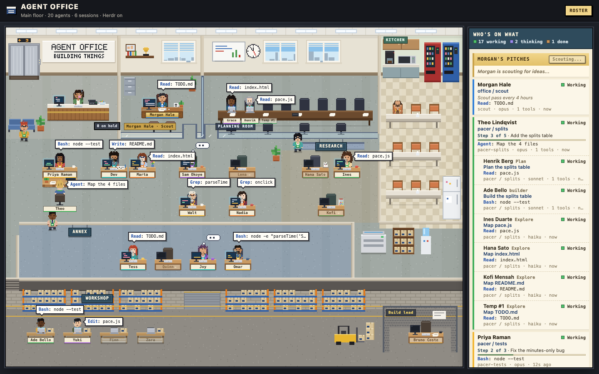

# Agent Office

A pixel-art office where every Claude Code session on your machine is a character at a desk.
Subagents walk in, sit with their department, show the tool they're running, and raise a hand when they need you.



*The built-in demo scene (`?scene=full&sky=day`). Every name, project and task in it is invented.*

## Quickstart

You need:

- macOS or Linux, and a browser.
- Python 3.9 or newer. Nothing to install: the server uses the standard library only.
- Claude Code. The office reads its local session files in `~/.claude`.
- Optional: [Herdr](https://herdr.dev), a terminal workspace for coding agents. You only need it for the scout and the `Assign` button. Everything else works without it.

```sh
git clone https://github.com/yasharya1/agent-office.git
cd agent-office
python3 setup.py --workspace ~/code   # the folder your agents work in; writes config.json
python3 server.py
```

Open <http://127.0.0.1:8765/>. Start a Claude Code session anywhere and it walks in.

Nothing running yet? Open <http://127.0.0.1:8765/?scene=full> to watch the demo scene, or <http://127.0.0.1:8765/?fixture=1> for static sample data.

## What you see

- **The floor.** One character per agent. Sessions sit in the bullpen, researchers in Research, builders in the Workshop and planners in the Planning room. When a department runs out of desks, the extra agent is a Temp. A lanyard color ties each agent to the session that started it.
- **Speech bubbles.** The tool each agent is running right now, for example `Edit: office.js`.
- **The front desk.** When an agent waits for your approval, the receptionist puts it on hold and the roster turns red.
- **The roster.** A sidebar with every agent: its goal (todo progress, session title or first prompt), its last tool, and how long it has waited for you.
- **Alerts.** Turn on `Alerts` for a desktop notification when an agent needs you.
- **The scout (optional, off by default).** A Claude Code session that reads your notes, pitches small tasks and starts a builder for each one you assign. See [The scout and Assign](#the-scout-and-assign).

## How it works

- `server.py` reads `~/.claude/sessions` and the last 128 KB of each session's transcript. It works out who is running, which subagents each session has out, what tool each one is using, and whether it is waiting on you.
- The page asks the server for that state every 1.5 seconds and draws the office. Every character, desk and sign is drawn in code; there are no image files.
- Everything stays on your machine. The server listens on `127.0.0.1` only and sends nothing anywhere.
- It never writes to `~/.claude` and never logs requests or transcript text.
- Tool targets and goals are cut to 80 characters, and strings that look like keys, tokens or passwords become `***` before they reach the page.
- Transcripts can hold private data. The page shows only short snippets, and only to your own machine.

With Herdr installed, the office also shows which terminal started which agent, and groups agents by Herdr tab. Without it (no `hc` on your PATH), the header says `Herdr off`, every Claude Code session still shows with its subagents, and the scout stays off with a note saying why.

## Configuration

`config.json` sits next to `server.py`. `setup.py` writes a starter one; `config.example.json` lists every key with its default and a comment. Lines that start with `//` are comments. Keys you leave out keep their default. Relative paths are relative to the folder that holds `config.json`. To use another file, run `python3 server.py --config PATH` or set `AGENT_OFFICE_CONFIG`.

| Key | Default | What it does |
|---|---|---|
| `workspace` | `~` | The folder your agents work in. The scout runs here. |
| `port` | `8765` | The page listens on `127.0.0.1` only. |
| `theme` | `default` | The cast and signs: `web/themes/<theme>.js`. |
| `claude_home` | `~/.claude` | Where Claude Code keeps sessions and transcripts. Read only. |
| `hc_bin` | `hc` | The Herdr command line tool. |
| `only_under` | `[]` | Show only agents whose working folder is inside one of these folders, for example `["~/demo"]`. Empty shows every agent. Handy for screen recordings. |
| `departments` | `[]` | Department names for the `?fixture=big` demo. |
| `roles` | see example | The role line under each name, per agent kind and subagent type. |
| `scout.enabled` | `false` | Turns the scout on. Read [Security](#security) first. |
| `scout.name` | `scout` | The scout's terminal name. The server only sends messages to this name. |
| `scout.orders`, `scout.pitches` | `scout/SCOUT.md`, `scout/pitches.json` | Its standing orders and its pitch file. |
| `scout.every_minutes` | `30` | How often it looks for work. |
| `scout.max_open`, `scout.max_running` | `2`, `1` | Open pitches at once, and builders running at once. |
| `scout.hours` | Mon to Fri, 09:00 to 17:00 UTC | When it may scout. |
| `scout.sources` | `README.md`, `TODO.md`, `CLAUDE.md` | Files it reads for work. Globs work. |
| `scout.skip_permissions` | `false` | Starts the scout with no approval prompts. See the risk below. |
| `builder.disallowed_tools` | chat and email connectors | Tools the scout and its builders can never use. |
| `builder.skip_permissions` | `false` | Starts builders with no approval prompts. See the risk below. |
| `herdr.space`, `herdr.tab` | `null` | Where the scout's terminal shows. `null` means the tab you start it from. |

## Themes: make your own cast

A theme names the cast, writes their idle quips and draws the office signs. `web/themes/default.js` is the only theme that ships, with an invented cast and plain job titles.

1. Copy `web/themes/default.js` to `web/themes/<name>.js` (lowercase letters, digits, `-` and `_`).
2. Change the names, titles, looks and quips. Each character is drawn from fields such as skin, hair style, shirt color, top, glasses and facial hair; `office.js` lists the options (`hairFront`, `torso`).
3. Keep the pool keys (`top`, `research`, `builder`, `reviewer`, `debugger`, `plan`, `guide`, `annex`, and `codex` for contractors). They decide who sits where.
4. Set `"theme": "<name>"` in `config.json` and reload. An unknown theme name falls back to the default.

The page remembers which character each agent got in your browser's local storage, so a session keeps its face across reloads.

## Demo scenes: `?scene=`

`?scene=<name>` plays `fixtures/scenes/<name>.json` instead of reading real sessions. The office is drawn by the same code as live; only the data is scripted, so every take looks the same. Scenes never start an agent and never POST to the server, so `Assign` and `Scout` are safe to click.

| Scene | What happens |
|---|---|
| `scout` | The scout reads the repo and pitches 2 jobs. Click `Assign` on the first and a builder walks in. |
| `hand` | A lead raises its hand for approval. Press Space to approve. |
| `temp` | A lead sends out 4 researchers. Research has 3 desks, so the 4th is a Temp. |
| `full` | All of the above on one floor. |

- **Keys:** Space or the right arrow fires the next waiting beat, `R` restarts, `H` toggles the progress bar.
- **URL options:** `&sky=day` (also `night`, `dawn`, `gold`, `dusk`) fixes the window light; `&hud=1` shows the progress bar from the start.
- **Write your own:** a scene is a list of beats that add, change or remove agents and pitches. `fixtures/scenes/make_scenes.py` builds the four examples; run `python3 fixtures/scenes/make_scenes.py fixtures/scenes` after you edit it.

## The scout and Assign

The scout is an optional Claude Code session in a Herdr terminal. It is off by default and needs Herdr.

1. Every `scout.every_minutes`, inside `scout.hours`, it reads `scout.sources` and looks for small jobs: a known fix nobody built, docs that disagree with the code, a missing test, a cleanup you asked for.
2. It writes up to `scout.max_open` pitches to its pitch file. They show at the top of the roster.
3. You click `Assign` or `Dismiss`. Nothing runs until you click `Assign`.
4. On `Assign`, it makes a new git worktree and branch, writes a brief, and starts a fresh builder terminal for that one job.
5. The builder commits on its branch and reports back. It never merges or pushes. You review and merge.

To set it up:

1. Install the skill: `python3 setup.py --install-skill`. It copies `skill/agent-office-scout` to `~/.claude/skills/`.
2. In Claude Code, ask it to set up the Agent Office scout. The skill reads your CLAUDE.md, task lists and project notes, suggests config changes, and writes `scout/SCOUT.draft.md` from `scout/SCOUT.template.md`. It does not start anything.
3. Read and edit the draft, then rename it to `scout/SCOUT.md`.
4. Set `scout.enabled` to `true` in `config.json`.
5. From a Herdr pane, run `scout/start.sh`.

## Security

- **Localhost only.** The server binds `127.0.0.1`. Nothing else on your network can reach it.
- **Host-header check.** Every request must say `Host: 127.0.0.1:<port>` or `localhost:<port>`. A web page that points its own domain at your machine (DNS rebinding) gets a 403.
- **One write endpoint.** Everything else is read only. `POST /api/pitch` accepts only requests from the page's own origin, with an `X-Agent-Office: 1` header, a JSON body under 1 KB, and a pitch id of a fixed shape. Its only effect is one message to the scout's terminal: `ASSIGN p-...`, `DISMISS p-...` or `SCOUT`. It never edits the pitch file; the scout does.
- **Blocked tools.** The scout and every builder start with `claude --disallowedTools` and the `builder.disallowed_tools` list. The defaults block common chat and email connectors. Add every tool in your setup that can send a message or change data outside the repo: chat, email, CRM, tickets, deploys, databases.
- **Caps.** At most `scout.max_open` open pitches and `scout.max_running` builders at once.
- **Approval prompts stay on by default.** With `skip_permissions` set to `false`, the scout and each builder ask before they run a command or edit a file, and you answer in their terminal.
- **The risk of `skip_permissions`.** Setting `scout.skip_permissions` or `builder.skip_permissions` to `true` adds `--dangerously-skip-permissions`. That agent then runs shell commands, edits files and starts other agents without asking you. A wrong pitch, a bad instruction in a file it reads, or a mistake in its orders can delete or change files on your machine. Turn it on only if you accept that, keep the blocked-tools list complete, and watch the terminals.

## Tests

```sh
python3 -m unittest -v test_package
```

They use temp folders and never touch `~/.claude`, Herdr or Claude Code. To check the page script too: `node --check web/office.js`.

## Roadmap

- Sign-off step: finished work goes to a reviewer desk before merge (planned).

## Uninstall

1. Stop `server.py` (Ctrl-C).
2. If the scout runs, stop it in its Herdr terminal.
3. Delete this folder.
4. If you installed the skill, delete `~/.claude/skills/agent-office-scout`.

The office keeps its cast and roster choices in your browser's local storage for `127.0.0.1`. Clear site data for that address to remove them.

## Names

Claude Code and Herdr are named here only as tools this project works with. This project is not affiliated with or endorsed by their makers. The default cast, art and lettering are original and drawn in code.

## License

MIT. See [`LICENSE`](LICENSE).
